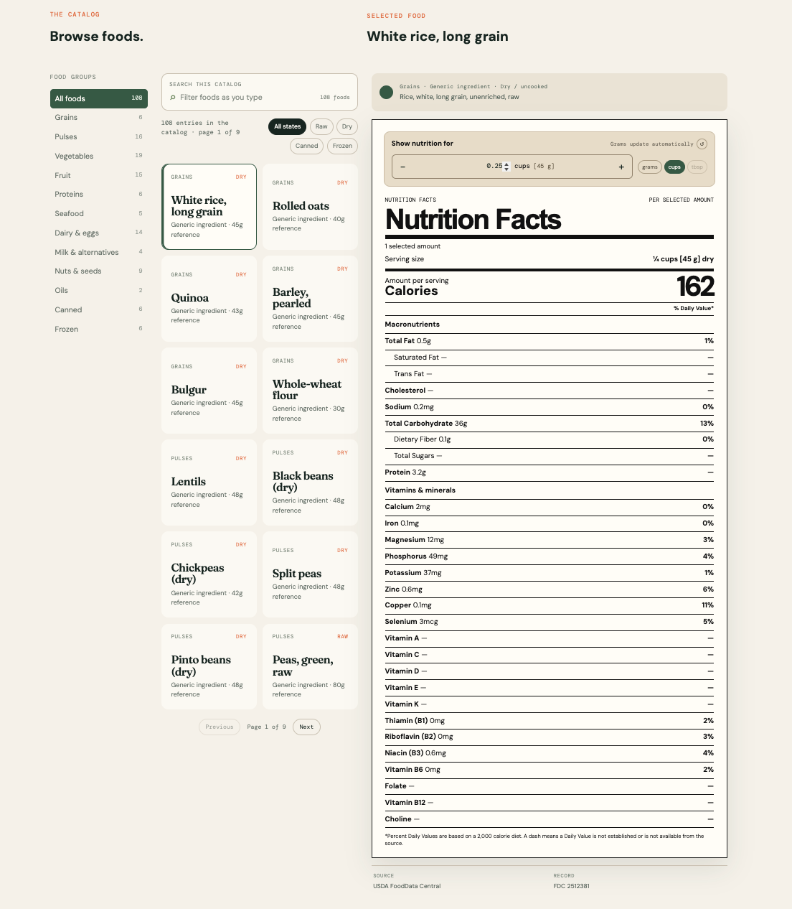
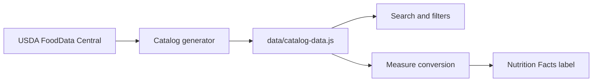

<div align="center">

# Pantry Index

A personal catalog of nutrition labels, built so I can plan my nutrition more easily and never google "xyz nutrition" again.

[](https://kaushik-3009.github.io/nutrition-rolodex/)
[](https://github.com/kaushik-3009/nutrition-rolodex)
[](https://fdc.nal.usda.gov/)
[](https://kaushik-3009.github.io/nutrition-rolodex/)

[Open the catalog](https://kaushik-3009.github.io/nutrition-rolodex/) · [About](https://kaushik-3009.github.io/nutrition-rolodex/about.html)



</div>

## Why

I constantly look up nutrition info, especially to check lesser-known nutrients like vitamin K or magnesium in staples like rice, oats, and lentils. Standard labels don't show these, so I always ended up digging through the same bloated websites with inconsistent serving sizes and ad spam. 

Pantry Index solves this problem for me, and I hope it does for you too. It gives each ingredient a single, easy-to-read, comprehensive nutrition record with a kitchen-friendly measure and its exact gram equivalent.

## Features

- Search 7,857 source-backed foods by name, words, group, or preparation state.
- Scale a food label by edible grams or use an available USDA reference portion.
- Add beside the quantity field, then use Search next food to build a menu quickly.
- Search within a food group or use the main search across all groups and preparations.
- Add foods to a daily menu, adjust gram quantities, remove items, and undo edits or clearing.
- See all selected foods combined in one nutrition label, with nutrient coverage and general Daily Values.
- Save a reusable day plan in this browser and download its entries and totals as JSON.

## Run and test

The application has no package dependencies, build step, backend, or API key requirement.
From the checkout:

```sh
python3 -m http.server 8000 --bind 127.0.0.1
```

Open the site with your local browser. Calculation and catalog checks use Node.js 24:

```sh
node --test tests/*.test.cjs
node scripts/audit-catalog.mjs --out /tmp/catalog-audit.json
```

For browser integration checks, install Python Playwright and Chromium in your
local development environment, then run against the running server:

```sh
python3 tests/browser_smoke.py
python3 tests/menu_walkthrough.py http://127.0.0.1:8000
python3 tests/browser_walkthrough.py
```

The test uses `/usr/bin/chromium` by default; set `CHROMIUM_PATH` for another
installation. It exercises adding/merging foods, scaling totals, editing,
invalid inputs, persistence, undo, export, missing nutrient coverage, search,
source portions, filters, mobile layout and the About page. The GitHub Pages
workflow runs the Node checks and all three browser scripts before deploying.
The full walkthrough repeats five-food search → quantity → add flows at 1440,
1024, 768, 390 and 320 CSS pixels, checks desktop/mobile layout and keyboard
entry, and verifies exported amounts and calories against the selected foods.

## Nutrition data and accuracy

The catalog contains all **7,793 USDA SR Legacy foods** from the official April
2018 CSV release, plus **64 additional FoodData Central records**. The original
108 entries were checked against all 105 distinct FDC IDs in the official API;
three duplicate representations were removed. Every display name now uses the
actual source description, including preparation and cut/species qualifiers.
See [the original-catalog audit](data/catalog-audit.json) for the identified
problems and [the reconciliation manifest](data/sr-legacy-reconciliation.json)
for source hashes, nutrient mappings and full-import verification counts.

Corrections include cooked quinoa labeled dry, unspecified kidney beans labeled
dry, unsupported meat/fish qualifiers, duplicate whole/split pulse records,
unsupported household estimates, and folate DFE mislabeled as total folate.
Current source values replace old rounded values. Original curated IDs are kept
where possible; there is one record per FDC ID, rather than fabricated variants
for cultivars or processing states that the source does not establish.

Each food stores 35 mapped nutrient quantities per 100 edible grams, including
energy, macros, vitamins and minerals. **Not every nutrient is reported for every
food.** Missing values remain `null`, distinct from reported zero. Daily totals
show a known subtotal with `≥` and coverage when any selected food lacks that
nutrient; the corresponding Daily Value is withheld. An entirely unknown total
shows a dash. Folate total and folate DFE are separate; only DFE is compared with
the folate Daily Value. Vitamin A uses RAE. Niacin in mg is not treated as niacin
equivalents, and protein %DV is not inferred from unmeasured protein quality.
Energy prefers USDA nutrient 1008, then Atwater general (2047), then specific
(2048). Source portion weights are used directly; no unsupported cup or piece
weights are invented. Weigh the edible portion in the same preparation state as
the selected record.

The expanded dataset is historical: it does not verify current branded labels,
guarantee a particular food's laboratory composition, cover every world food, or
provide every nutrient for every record. Daily Values are general FDA references
for adults and children 4 years and older, not personalized dietary requirements.
Source reconciliation verifies identity, values, units, missing data and portion
weights against the chosen source; it is not an independent laboratory analysis.

## Rebuild the catalog

Download the official
[`FoodData_Central_sr_legacy_food_csv_2018-04.zip`](https://fdc.nal.usda.gov/fdc-datasets/FoodData_Central_sr_legacy_food_csv_2018-04.zip)
archive and, from the checkout, run:

```sh
node scripts/import-sr-legacy.mjs /path/to/FoodData_Central_sr_legacy_food_csv_2018-04.zip
node scripts/import-sr-legacy.mjs /path/to/FoodData_Central_sr_legacy_food_csv_2018-04.zip --check
```

Requires Node.js and `unzip`. The importer verifies the archive SHA-256
`b80817294b8850530aaedf2e515c02593b1824f763a0ff356e5c2081643e6fd0`,
checks nutrient IDs, names and source units against `nutrient.csv`, then rebuilds
all records. The additional original-source records are reproduced from the
checked-in, checksum-pinned [public USDA API snapshot](data/curated-source.json).
The raw API response digest and the compact snapshot digest are recorded in the
reconciliation manifest. Review source updates deliberately; do not change a hash
merely to make a failed integrity check pass.

The importer rereads the emitted catalog and reconciles every selected nutrient
cell and eligible source portion. `--check` verifies both generated files without
modifying them. Repeated builds produce identical output. The former fuzzy-search
generator, `scripts/fetch-catalog.mjs`, now delegates to this importer rather than
silently selecting the first API search result and overwriting the catalog.

## Under the hood

The browser scales per-100 g values to the selected edible weight. `nutrition.js`
validates units and sums unrounded values; `menu.js` handles the local day plan.
Rounding happens only for display. Plans stay on the current browser/device;
there is no account sync or automatic rollover to a new date. JSON download is
an export, not an import/restore feature.



State nuances: raw, dry, canned, and frozen versions of the same food are separate records because their nutrition differs.

## Scope

USDA reference foods include ingredients, prepared foods and historical restaurant/product records. Treat current package labels as the source for current branded products; a generic USDA food is not an interchangeable brand label.

## Tech

Dependency-free: HTML, CSS, vanilla JavaScript. Data generated by `scripts/import-sr-legacy.mjs`. Deployed to GitHub Pages via GitHub Actions.

## Roadmap

- Verified branded records
- Barcode lookup
- Meal templates, dated food logs and plan import
- Optional personalized targets with clear source references
- Contribution process with review trail

## Disclaimer

Reference tool, not medical advice.


