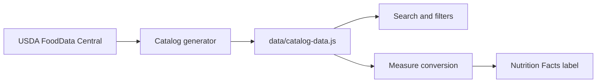

# Pantry Index

A personal catalog of nutrition labels, built so I can plan my nutrition more easily and never google "xyz nutrition" again.

[Open the catalog](https://kaushik-3009.github.io/nutrition-rolodex/) · [About](https://kaushik-3009.github.io/nutrition-rolodex/about.html)

## Why

I constantly look up nutrition info, especially to check lesser-known nutrients like vitamin K or magnesium in staples like rice, oats, and lentils. Standard labels don't show these, so I always ended up digging through the same bloated websites with inconsistent serving sizes and ad spam. 

Pantry Index solves this problem for me, and I hope it does for you too. It gives each ingredient a single, easy-to-read, comprehensive nutrition record with a kitchen-friendly measure and its exact gram equivalent.

## Features

- Search by ingredient, alias, food group, or state (raw, dry, canned, frozen)
- Adjust quantities in grams, cups, tablespoons, or counts (egg, slice)
- Nutrition Facts label recalculates live for the selected amount
- 108 generic records from USDA FoodData Central
- There's a lot missing, I may add those at some point.
  
## Under the hood

Each record stores nutrients per 100 grams. The browser converts the chosen measure to grams and scales from that single source, so there are no duplicate records per serving size.

State nuances: raw, dry, canned, and frozen versions of the same food are separate records because their nutrition differs.

## Scope

Generic ingredients only. Branded items (Walmart, Great Value) will be added only when package data can be verified, since a generic USDA record is not a package label.

## Tech

Dependency-free: HTML, CSS, vanilla JavaScript. Data file generated by `scripts/fetch-catalog.mjs`. Deployed to GitHub Pages via GitHub Actions.

## Roadmap

- Verified branded records
- Barcode lookup
- Saved personal items
- Contribution process with review trail

## Disclaimer

Reference tool, not medical advice.

