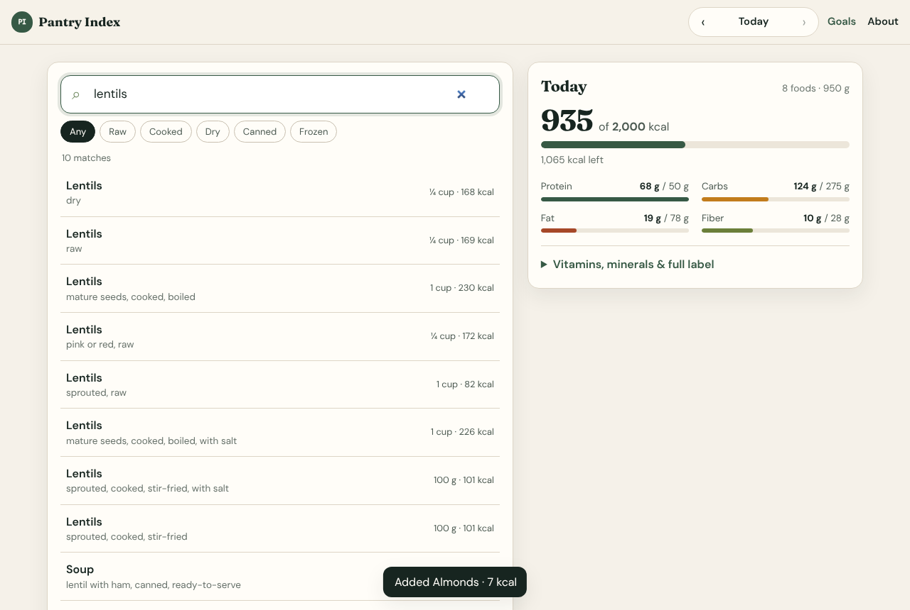
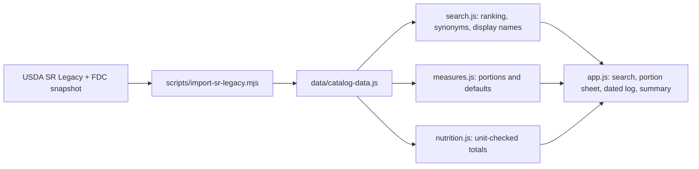

<div align="center">

# Pantry Index

Search a food, pick a real portion, and see your whole day add up — built so I never google "xyz nutrition" again.

[](https://kaushik-3009.github.io/nutrition-rolodex/)
[](https://github.com/kaushik-3009/nutrition-rolodex)
[](https://fdc.nal.usda.gov/)
[](https://kaushik-3009.github.io/nutrition-rolodex/)

[Open the catalog](https://kaushik-3009.github.io/nutrition-rolodex/) · [About](https://kaushik-3009.github.io/nutrition-rolodex/about.html)



</div>

## Why

I constantly look up nutrition info, especially to check lesser-known nutrients like vitamin K or magnesium in staples like rice, oats, and lentils. Standard labels don't show these, so I always ended up digging through the same bloated websites with inconsistent serving sizes and ad spam. 

Pantry Index solves this problem for me, and I hope it does for you too. It gives each ingredient a single, easy-to-read, comprehensive nutrition record with a kitchen-friendly measure and its exact gram equivalent.

## Features

- **One ranked search** over 7,857 USDA foods. Everyday staples come first ("rice" → cooked rice, "eggs" → whole egg), plurals and common synonyms work (chickpeas/garbanzo, curd/yogurt, dal/lentils, ketchup/catsup), and group names no longer cause false matches.
- **Real portions for each food.** Every usable USDA portion for that exact record — 1 medium banana, 1 slice, 1 breast, 1 cup chopped, 1 fl oz — plus grams and ounces. Spoon sizes are only derived from a plain cup (oil, milk, flour), never "1 tbsp of banana". Sensible defaults: 1 large egg, 1 tbsp olive oil, 1 slice of bread, 3 oz cooked meat.
- **Daily log by meal** (breakfast, lunch, dinner, snacks), saved per date in this browser. Look back with ‹ ›, copy a previous day, edit or remove entries with undo.
- **Day summary** of calories and protein/carbs/fat/fiber against your own goals, key vitamins and minerals as % of Daily Value, and a full Nutrition Facts label for the day or for any single portion.
- Keyboard friendly: <kbd>/</kbd> focuses search, <kbd>Enter</kbd> opens the top result, arrow keys move through results and change amounts. Fractions like `1/2` and `1 1/2` work.

## Run and test

No dependencies, build step, backend or API key. From the checkout:

```sh
python3 -m http.server 8000 --bind 127.0.0.1
```

Calculation, catalog, portion and search checks (Node.js 24):

```sh
node --test tests/*.test.cjs
node scripts/audit-catalog.mjs --out /tmp/catalog-audit.json
```

Browser walkthrough (Python Playwright + Chromium; set `CHROMIUM_PATH` if needed) against the running server, at desktop, phone and 320 px widths:

```sh
python3 tests/tracker_walkthrough.py http://127.0.0.1:8000
```

The GitHub Pages workflow runs all of these before deploying.

## Nutrition data and accuracy

The catalog contains all **7,793 USDA SR Legacy foods** (April 2018 CSV release) plus **64 newer FoodData Central Foundation/FNDDS records** for common staples. Values are stored per 100 edible grams for 35 nutrients; missing values stay `null`, distinct from a reported zero. Portion weights are USDA's measured gram weights for that record.

A November 2026 accuracy audit spot-checked ~30 everyday foods against USDA values (all matched) and checked every record for impossible relationships. The importer now also:

- **Fills gaps in sparse Foundation records.** 36 of them reported as few as 7–20 of 35 nutrients (the old default "white rice" had no saturated fat, sugars or vitamins). Only their *missing* nutrients are filled from the closest SR Legacy record, listed in `BACKFILL` in the importer; reported values are never replaced. Each such food carries a `backfill` record (donor FDC ID and keys), and the app says so in the food's details.
- **Uses Atwater-specific energy (2048) before Atwater-general (2047)** for Foundation records, matching USDA's own preference. General factors overstated calories by 7–21% for nuts and some vegetables (almonds 626 → 584 kcal/100 g).
- **Classifies preparation state with ordered rules.** About 700 records changed: "cooked, dry heat" fish is cooked (not dry), "dry mix, prepared with milk" is cooked, raw rice and pulses are dry, and frozen-then-cooked foods are cooked.

Energy prefers USDA nutrient 1008, then 2048, then 2047. Folate total and folate DFE are separate; only DFE is compared with the Daily Value. Vitamin A uses RAE. Totals show `≥` with coverage when some foods lack a nutrient, and %DV is withheld for incomplete totals. Added sugars, iodine and biotin are hidden in the app because the sources report them for almost no foods.

The data is historical reference data: it does not verify current branded labels or guarantee a particular food's composition. Daily Values are general FDA references for adults, not personal requirements.

## Rebuild the catalog

Download the official
[`FoodData_Central_sr_legacy_food_csv_2018-04.zip`](https://fdc.nal.usda.gov/fdc-datasets/FoodData_Central_sr_legacy_food_csv_2018-04.zip)
archive and, from the checkout, run:

```sh
node scripts/import-sr-legacy.mjs /path/to/FoodData_Central_sr_legacy_food_csv_2018-04.zip
node scripts/import-sr-legacy.mjs /path/to/FoodData_Central_sr_legacy_food_csv_2018-04.zip --check
```

Requires Node.js and `unzip`. The importer verifies the archive SHA-256
`b80817294b8850530aaedf2e515c02593b1824f763a0ff356e5c2081643e6fd0`,
checks nutrient IDs, names and source units against `nutrient.csv`, then rebuilds
all records. The additional original-source records are reproduced from the
checked-in, checksum-pinned [public USDA API snapshot](data/curated-source.json).
The raw API response digest and the compact snapshot digest are recorded in the
reconciliation manifest. Review source updates deliberately; do not change a hash
merely to make a failed integrity check pass.

The importer rereads the emitted catalog and reconciles every selected nutrient
cell and eligible source portion. `--check` verifies both generated files without
modifying them. Repeated builds produce identical output. The former fuzzy-search
generator, `scripts/fetch-catalog.mjs`, now delegates to this importer rather than
silently selecting the first API search result and overwriting the catalog.

## Under the hood



`nutrition.js` validates units and sums unrounded values; rounding happens only for display. The log is stored in `localStorage` (`pantry-index-v2`) as dated days of `{foodId, grams, measureId, amount, meal}`; the old single "day plan" is migrated into today on first load. Download exports a day as JSON with per-food amounts and totals.

## Tech

Dependency-free HTML, CSS and vanilla JavaScript, deployed to GitHub Pages via GitHub Actions. Fonts are served locally from `public/fonts/` (OFL).

## Roadmap

- Verified branded records and barcode lookup
- Saved meals / recipes (one tap for "my usual breakfast")
- Import a downloaded day; optional sync across devices

## Disclaimer

Reference tool, not medical advice.
