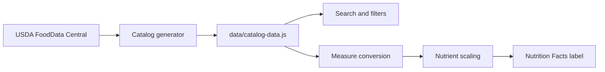

<div align="center">

# Pantry Index

I kept searching for the same nutrition labels, so I made a place to keep them.

[](https://kaushik-3009.github.io/nutrition-rolodex/)
[](https://github.com/kaushik-3009/nutrition-rolodex)
[](https://fdc.nal.usda.gov/)
[](https://kaushik-3009.github.io/nutrition-rolodex/)

[Open the catalog](https://kaushik-3009.github.io/nutrition-rolodex/) · [Read the story](https://kaushik-3009.github.io/nutrition-rolodex/about.html)


</div>

## The reason I built it

I was regularly searching for things like “Great Value white rice nutrition” and then repeating the same process for oats, lentils, beans, vegetables, and milk. The information was usually somewhere, but the serving sizes were inconsistent and the label was often buried in a product page or a photo.

Pantry Index is my attempt to make that lookup less annoying. It gives each ingredient one readable record, starts with a measure that makes sense in a kitchen, and keeps the gram equivalent beside it. The site is public because this was not only my problem.

## What the site does

Search the catalog by ingredient, alias, food group, or state. Select a record beside the results, adjust the amount, and read a Nutrition Facts style label for that exact quantity. A user can switch between grams, cups, tablespoons, and countable measures such as an egg or a slice.

The catalog keeps raw, dry, canned, and frozen foods separate. That matters for foods such as beans, peas, broccoli, and spinach, where the state changes both the serving convention and the nutrition values.

## The serving-size decision

Grams are the calculation basis, but they are not always the best starting point for a person standing in a kitchen. The default for rolled oats is `1/2 cup`; dry lentils and chickpeas start at `1/4 cup`; oils use tablespoons; eggs and slices can use a count measure. Each household amount shows its gram equivalent, and the label recalculates when the amount changes.

The important part is that the interface does not store a separate nutrition record for every serving size. Each record stores nutrients per 100 grams. The browser converts the chosen measure to grams and scales the nutrients from that one canonical basis.

## A small catalog with clear boundaries

The current release has 108 generic records covering grains, Indian pulses and dals, vegetables, fruit, proteins, seafood, dairy, eggs, milk, milk alternatives, nuts, seeds, oils, canned foods, and frozen foods.

It does not include cooked foods or multi-ingredient prepared foods. Walmart and Great Value products are a separate data problem because a generic USDA ingredient should not be presented as an exact package label. Those branded records will be added only when the package data can be verified.

## How the data moves



The generator keeps the source name and record ID with each entry. The browser uses the selected gram amount to scale calories, macronutrients, vitamins, minerals, and Daily Values where a reference value is available. Missing Daily Values remain missing instead of being guessed.

## Built with

The app is deliberately dependency-free: semantic HTML, CSS, and vanilla JavaScript on the frontend, with a generated JavaScript data file produced by the ingestion script. GitHub Actions is set up to publish the static files to GitHub Pages.

```text
index.html                  Catalog and Nutrition Facts markup
about.html                  The personal story and project scope
app.js                      Search, filtering, measures, and rendering
styles.css                  Layout, label styling, and responsive behavior
data/catalog-data.js        Generated catalog records
public/landing-page.png     Product screenshot
scripts/fetch-catalog.mjs   Source ingestion and record generation
```

## What I would add next

The next additions are verified Walmart and Great Value records, barcode lookup, saved personal items, and a contribution process with a review trail. The data model needs to preserve the difference between a generic reference and a package-specific label as the catalog grows.

## A necessary note about the numbers

Pantry Index is a reference tool, not medical advice. Nutrition values depend on the source record, food state, and selected measure. For a branded, fortified, or reformulated product, the package in hand is still the final reference.

There is no open-source license yet. Until one is added, the repository is source-available rather than freely reusable.
