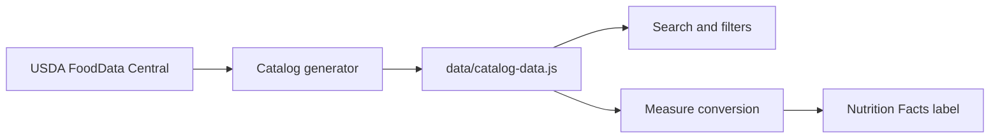

# Pantry Index

A personal catalog of nutrition labels, built so I can plan my nutrition more easily and never Google "xyz nutrition" again.

[Open the catalog](https://kaushik-3009.github.io/nutrition-rolodex/) · [About](https://kaushik-3009.github.io/nutrition-rolodex/about.html)

## Why

Looking up nutrition info for staples like rice, oats, and lentils meant digging through product pages with inconsistent serving sizes. Pantry Index gives each ingredient one readable record with a kitchen-friendly default measure and its gram equivalent.

## Features

- Search by ingredient, alias, food group, or state (raw, dry, canned, frozen)
- Adjust quantities in grams, cups, tablespoons, or counts (egg, slice)
- Nutrition Facts label recalculates live for the selected amount
- 108 generic records from USDA FoodData Central

## How it works

Each record stores nutrients per 100 grams. The browser converts the chosen measure to grams and scales from that single source, so there are no duplicate records per serving size.

State matters: raw, dry, canned, and frozen versions of the same food are separate records because their nutrition differs.

## Scope

Generic ingredients only, no cooked dishes or multi-ingredient products. Branded items (Walmart, Great Value) will be added only when package data can be verified, since a generic USDA record is not a package label.

## Tech

Dependency-free: HTML, CSS, vanilla JavaScript. Data file generated by `scripts/fetch-catalog.mjs`. Deployed to GitHub Pages via GitHub Actions.

## Roadmap

- Verified branded records
- Barcode lookup
- Saved personal items
- Contribution process with review trail

## Disclaimer

Reference tool, not medical advice. For branded or fortified products, the package label is the final word.

No license yet. The repository is source-available, not freely reusable.
