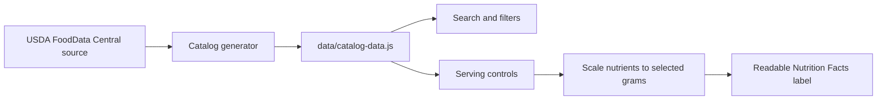

<div align="center">

# Pantry Index

### A searchable nutrition reference for the ingredients people actually keep at home.

Pantry Index turns the back-of-package lookup into a fast, readable web experience. Search a plain ingredient, choose a practical kitchen measure, and see a nutrition label that recalculates to that exact amount.

[Open the catalog](https://kaushik-3009.github.io/nutrition-rolodex/) · [View the repository](https://github.com/kaushik-3009/nutrition-rolodex)


</div>

## Why this exists

Nutrition information is easy to find in isolation and surprisingly difficult to compare in the moment. A search for white rice, lentils, spinach, or a can of beans often leads to a product page, an image of a label, or a serving size that is hard to translate into what someone is holding in a measuring cup.

Pantry Index is designed around that everyday lookup:

- Search by ingredient, alias, food group, or state.
- Start with a sensible household measure such as `1/2 cup`, `1/4 cup`, `1 tbsp`, `1 egg`, or `1 slice`.
- Keep the gram equivalent visible beside the household measure.
- Scale calories, macronutrients, vitamins, minerals, and Daily Values to the selected amount.
- Keep raw, dry, canned, and frozen records separate so similar foods are not quietly mixed together.

## Product highlights

| Capability | What it does |
| --- | --- |
| Inline catalog browsing | Select a food beside the results instead of jumping to a separate detail page. |
| Live search | Filter the catalog while typing by name, alias, group, or state. |
| Food-specific measures | Default amounts reflect how ingredients are normally measured in a kitchen. |
| Flexible serving controls | Adjust grams, cups, tablespoons, or countable units such as eggs and slices. |
| Nutrition Facts label | Reproduces the familiar back-label hierarchy with readable nutrient rows and `% Daily Value`. |
| Pagination | Keeps long groups usable instead of rendering an unbounded wall of cards. |
| Source-aware records | Each entry retains its source and record identifier for traceability. |
| Static delivery | No account, database, build server, or runtime API is required to browse the catalog. |

## Current catalog

The catalog currently contains 108 generated generic records across:

- Grains
- Indian pulses, lentils, dals, and beans
- Vegetables and fruit
- Proteins and seafood
- Dairy, eggs, milk, and milk alternatives
- Nuts, seeds, and oils
- Canned and frozen ingredients

The current data boundary is deliberate: records are raw, dry, canned, or frozen. Cooked foods and multi-ingredient prepared foods are outside the current catalog model. Walmart and Great Value product-specific records are planned as a separate verified ingestion stage, not silently substituted with generic data.

## How it works



The data pipeline normalizes nutrients to a per-100-gram basis. The browser converts a selected household measure into grams, scales every nutrient from that canonical basis, and calculates Daily Values only where a reference value exists. This keeps the measurement UI flexible without duplicating nutrition records for every possible serving size.

## Technical approach

- **Frontend:** semantic HTML, modern CSS, and vanilla JavaScript
- **Data:** generated JavaScript catalog with USDA FoodData Central provenance
- **Runtime:** dependency-free static site
- **Search:** client-side keyword matching across names, aliases, groups, states, and source labels
- **Serving math:** gram-canonical nutrient scaling with household and count-measure conversions
- **Deployment:** GitHub Pages through GitHub Actions
- **Accessibility:** semantic controls, visible labels, keyboard-friendly interactions, and responsive layouts

This is intentionally a small static application. The interesting engineering work is in the catalog shape, measurement model, nutrient scaling, and making a dense label readable without losing the speed of a simple lookup tool.

## Run locally

The site does not require a package install. Serve the repository from its root so the relative catalog and image paths resolve correctly:

```bash
python3 -m http.server 4173
```

Then open <http://localhost:4173>.

Opening `index.html` directly also works for the browser prototype, but a local static server is the better way to mirror deployment behavior.

## Verify the catalog

The generated catalog can be rebuilt from the ingestion script when the source cache is available:

```bash
FDC_LOCAL_DIR=/path/to/fdc-cache node scripts/fetch-catalog.mjs
node --check app.js
node --check data/catalog-data.js
```

The catalog is checked for duplicate IDs, core nutrient coverage, requested groups, and valid pagination. Product-specific Walmart data is not added until the source label and record can be verified.

## Repository map

```text
.
├── index.html                  Catalog shell and Nutrition Facts markup
├── about.html                  Project story and scope
├── app.js                      Search, filters, serving math, and rendering
├── styles.css                  Design system and responsive layout
├── data/catalog-data.js        Generated catalog records
├── public/landing-page.png     Product screenshot used in this README
└── scripts/fetch-catalog.mjs   Source ingestion and record generation
```

## What is next

The next meaningful product steps are verified Walmart and Great Value package records, barcode lookup, saved personal items, and a contribution workflow with a review trail. These should extend the source model rather than weaken the distinction between generic references and package-specific labels.

## Scope and limitations

Pantry Index is a reference and comparison tool, not medical advice. Nutrition values depend on the source record, food state, and selected measure. The current generic catalog should be checked against the package in hand when a package label is available, especially for branded, fortified, or reformulated products.

## License

No open-source license has been selected yet. Until one is added, treat the repository as source-available rather than freely reusable.
